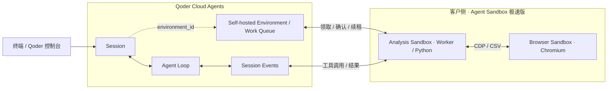

# Qoder Cloud Agents × Agent Sandbox 极速版

用 **Agent Sandbox 极速版**为 **Qoder Cloud Agents（QCA）** 提供 BYOC（Bring Your Own Cloud）执行环境。QCA 托管 Agent Loop，浏览器操作和 Python 代码在你自己的阿里云账号里运行。

示例用模拟数据跑三轮报表任务。第一轮下载 CSV 并分析，第二轮用同一份 CSV 回答追问，第三轮追加一条记录再重算。每轮调用了哪些工具、在哪个 Sandbox 跑、返回了什么，都可以在本机观察页看到。

## 快速开始

本机需要 Python 3.11+、Docker 和 Buildx。启动 Docker 后，备好阿里云 AK/SK、地域和 Qoder 国际站 PAT。使用临时阿里云凭证时还需要 STS Token。

```bash
git clone https://github.com/hongxiaolong/qoder-byoc-sandbox-example.git
cd qoder-byoc-sandbox-example
./start.sh
```

1. 向导安装依赖后，输入凭证，按提示选择或新建 Sandbox Team、API Key、ACR、网络和镜像仓库。新购 ACR 要单独确认。
2. 向导构建或复用 Browser 和 Analysis 模板，创建或恢复运行环境。终端会给出 Qoder 会话和本机观察页的地址。
3. 每轮从向导或 Qoder 控制台选一个入口发消息。默认三轮分别得到 **100、65、101 条记录**，都通过验收后，终端会打印 `LIVE_PASS`。之后可以在同一会话继续提问。
4. 跑完后，在菜单里选择保留环境或回收本轮运行。项目创建的准备资源也要一起回收时，选「回收运行和准备资源（含历史）」。

运行 `./start.sh --preview` 可以先看流程。遇到问题，查[实操指引](docs/live-demo.md)或[账号准备](docs/bootstrap.md)。

## Qoder 和 Sandbox 怎么配合



- Worker 从 **Work Queue** 领取会话级 Work，确认后定期续租。这个示例里，同一会话的多轮消息可以共用一条 Work。
- 用户消息、工具调用和结果都走 **Session Events**。QCA 根据上下文和 Skill 选工具。Worker 读到调用后运行 Python 或控制 Chromium，再把结果发回 QCA。

更多细节见[架构与 API 链路](docs/architecture.md)和[观察页说明](docs/live-observability.md)。

## 注意事项

- Sandbox 按使用量计费。向导会保留复用的资源。项目新购的预付费 ACR 需在「费用与成本 → 订单管理 → 退订管理」手动退订，关联的 OSS 单独处理。 [ACR 退订说明](https://help.aliyun.com/zh/acr/product-overview/refund-policy)
- 本机走公网推送 Analysis 镜像，Sandbox 平台通过所选 VPC 拉取。Docker 登录超时，可以先核对代理或 VPN 下的实际出口 IP 是否在 ACR 白名单里。 [网络与登录排障](docs/bootstrap.md)
- 按 `Ctrl+C` 退出会保留云资源和进度。保留 `var/state/`，重跑 `./start.sh` 时向导会检查已有进度。验收记录在 `var/results/<run_id>/`，需要的产物请在释放实例前保存。
- 工具参数、执行结果及部分数据会发回 Qoder。请使用模拟数据，并避免把本地凭证提交到仓库。 [安全边界](SECURITY.md)

[许可证](LICENSE) · [贡献指南](CONTRIBUTING.md)
